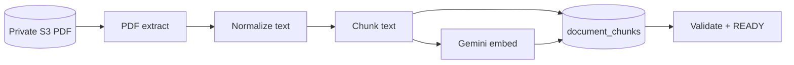

# Document processing — Phase 2B (indexing)

Phase 2B replaces the Phase 2A placeholder worker handler with a full pipeline:

**QUEUED → PROCESSING → READY**

Indexing completes only after text extraction, deterministic chunking, Gemini embeddings, and persistence succeed. Note-based RAG/chat is unchanged.

## Architecture



| Component | Location |
|-----------|----------|
| Worker loop | `scripts/document-processing-worker.ts` → `worker-run.ts` |
| Indexing handler | `src/lib/documents/indexing/index-document-handler.ts` |
| Finalize (READY + job SUCCEEDED) | `src/lib/documents/indexing/finalize-indexing.ts` |
| Chunk / vector I/O | `src/lib/documents/indexing/chunk-repository.ts` |

## Environment variables

| Variable | Purpose |
|----------|---------|
| `DATABASE_URL` | Worker + API (jobs, chunks) |
| `AWS_S3_DOCUMENT_BUCKET` | Private PDF bucket |
| `AWS_REGION` | S3 region (e.g. `eu-north-1`) |
| `AWS_PROFILE` | Local dev credentials profile (e.g. `mindvault-dev`) |
| `GEMINI_API_KEY` | Chunk embeddings (`gemini-embedding-001`) |
| `MINDVAULT_DOCUMENT_UPLOAD_ENABLED` | `true` to allow uploads |

Optional tuning: `MINDVAULT_JOB_LEASE_MS`, `MINDVAULT_JOB_OPERATION_TIMEOUT_MS`, `MINDVAULT_WORKER_POLL_MS` (see `job-config.ts`).

## Phase 2A placeholder reconciliation

Placeholder jobs were marked `SUCCEEDED` while documents stayed `QUEUED` with **no** chunks.

Idempotent CLI:

```bash
npm run documents:jobs:reconcile
```

Logic (`reconcilePlaceholderSucceededJobs`):

1. Job `SUCCEEDED` + document `QUEUED`.
2. Skip `READY` documents.
3. Skip if any `document_chunks` exist for `(documentId, processingVersion)`.
4. Reset job to `PENDING` (clears lease/completedAt) for the real worker.

Does not delete S3 objects or change document IDs.

## PDF extraction

- **Library:** `pdfjs-dist` (legacy Node build).
- **Source:** `readObjectBytes` from private S3 (size-capped to upload max).
- **Output:** Per-page text + page numbers (citations in Phase 3).
- **Limits:** 50 MiB, 500 pages, 90s extraction budget.
- **Failures:** corrupt, encrypted, empty, image-only, too large, timeout → `ProcessingError` (permanent/transient).
- **No OCR**, no full-PDF Gemini extraction.

## Normalization

`normalizePageText` — deterministic whitespace, line breaks, and common PDF artifacts; preserves unicode and punctuation.

## Chunking

No in-app tokenizer; **~4 characters per token** (documented approximation).

| Setting | Tokens (approx.) | Characters |
|---------|------------------|------------|
| Target | ~600 | 2,400 |
| Maximum | ~800 | 3,200 |
| Overlap | ~100 | 400 |

Paragraph/sentence-aware splitting in `chunk-text.ts`. Stable `(documentId, processingVersion, chunkIndex)`.

## Embeddings

- `embedText({ taskType: "note" })` → Gemini `RETRIEVAL_DOCUMENT`.
- Model: `gemini-embedding-001`, **768** dimensions (pgvector).
- Input: `buildDocumentChunkEmbeddingInput(documentTitle, chunkContent)`.
- Concurrency: **3** parallel embeds (`embed-chunks.ts`); retries inside `embedText` + job-level retry for failures.

## Database

Migration **`20261013190000_add_document_chunks`**:

- `document_chunks` with nullable `vector(768)` until embedded.
- Unique `(document_id, processing_version, chunk_index)`.
- `ON DELETE CASCADE` from `documents`.
- Progress on `documents`: `processing_stage`, `processing_total_chunks`, `processing_completed_chunks`.

`NoteEmbedding` is untouched.

## Processing version

`Document.processingVersion` → `PIPELINE_SPECS` in `processing-version.ts` (extraction limits, chunking, embedding model/dimensions). Do not mix chunks across versions; bump version + new job when changing pipeline config.

## Checkpointing / worker recovery

1. Upsert chunk **content** idempotently.
2. Embed only rows with `embedding IS NULL`.
3. After crash: reclaim job → re-extract (deterministic) → upsert → embed missing → finalize.
4. Regenerating one embedding after crash-before-save is acceptable.
5. `finalizeDocumentIndexing` requires all chunks embedded at 768 dims + valid `claimGeneration` fence.

## Failure handling

Uses Phase 2A retries/leases. Permanent: missing S3 object, corrupt/encrypted/empty/image-only PDF. Transient: timeouts, rate limits, DB blips, lost lease. Deletion → job cancelled; no document resurrection.

## Progress UI

API serialization sets `processingLabel` from stage + optional `(completed/total)` during embedding. Stages: Extracting text, Preparing chunks, Generating embeddings, Finalizing document. **Ready** only when `Document.status = READY`.

## Local commands

```bash
# Migrations (once per DB)
npm run db:migrate

# Requeue placeholder jobs (once after upgrading from 2A)
npm run documents:jobs:reconcile

# Worker (separate terminal)
npm run documents:worker

# Tests (mocked S3/Gemini)
npm run test:documents
```

Presign check (no object upload):

```bash
npx tsx scripts/verify-s3-presign.ts
```

## Test with a real PDF

1. `.env` / `.env.local`: `DATABASE_URL`, S3 bucket/region/profile, `GEMINI_API_KEY`, `MINDVAULT_DOCUMENT_UPLOAD_ENABLED=true`.
2. `npm run dev` → http://localhost:3003 → upload a **text-based** PDF.
3. `npm run documents:worker` in another terminal.
4. Watch document status: Processing → stage labels → **Ready**.
5. Optional DB check: `document_chunks` rows with non-null embeddings for that `document_id`.

After Phase 2A placeholders:

```bash
npm run documents:jobs:reconcile
npm run documents:worker
```

## Limitations

- Text PDFs only (no OCR).
- No document RAG, mixed retrieval, or PDF chat (Phase 3).
- Re-extraction on retry; stored embeddings reused when present.

## Phase 3 readiness

- Chunk text + `pageStart`/`pageEnd` + `vector(768)` stored per user document.
- Next: user-scoped vector search, mixed note+document retrieval, citations.
