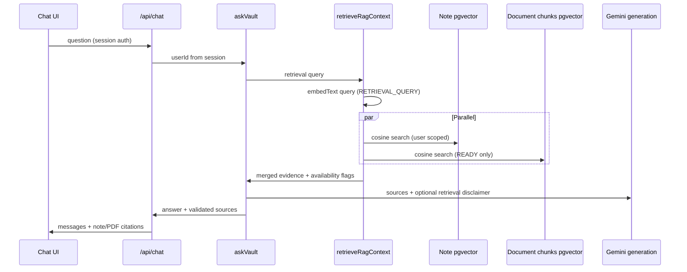

# Unified RAG — Phase 3 (notes + PDF documents)

MindVault Ask chat now retrieves **notes** and **READY document chunks** in one pipeline, then generates a single grounded answer with validated citations.

## Data flow

## Document search

- Module: `src/lib/documents/document-chunk-search.ts`
- SQL joins `document_chunks` → `documents` with `d.user_id = $sessionUserId` and `d.status = 'READY'`.
- Cosine similarity via pgvector `<=>` (same pattern as notes).
- Parameterized `$queryRaw` only; query text is embedded to numbers before SQL.

## Mixed evidence selection

- Module: `src/lib/rag/select-evidence.ts`
- Defaults: top 5 notes + top 5 chunk candidates → merge by similarity → max **8** total, max **3** chunks per document, min similarity **0.6**.
- Single query embedding shared by both searches (no duplicate embed call).

## Graceful degradation

- Note and document DB searches run in parallel with an **8s** timeout each.
- If one side fails, the other can still answer; `buildRetrievalDisclaimer` informs the model not to claim full vault coverage.
- If **both** fail → `provider_failure` (unchanged from total retrieval failure).

## Generation & citations

- Prompt distinguishes **notes** vs **PDF excerpts** with page numbers (`build-context.ts`).
- Model cites by source number; server keeps only citations matching retrieved sources (existing pattern).
- `AskVaultSource` discriminated union: `kind: "note" | "document"` (legacy note rows without `kind` still parse as notes).

## Security

- `userId` only from authenticated session in `/api/chat` → `processChatMessage` → `askVault`.
- Document chunks never returned for other users or non-`READY` documents.
- PDF text treated as untrusted in system instructions (prompt injection mitigation).

## Performance

- One query embedding per turn.
- Bounded top-k and context truncation (2000 chars per source excerpt).
- No ANN index on `document_chunks` yet — sequential scan acceptable at current scale; add HNSW when chunk volume grows.

## Environment

Same as Phase 2B for indexing; chat additionally requires `GEMINI_API_KEY`.

## Manual testing

1. Ensure at least one **READY** PDF and one embedded note exist.
2. `npm run dev` + `npm run documents:worker` (if re-indexing).
3. Open **Vault → Chat**, ask a question that matches both note and PDF content.
4. Confirm **Related content** lists notes and PDF lines with page numbers.
5. Click a PDF citation → `/vault/documents?doc=<id>&page=<n>` highlights the document.

## Limitations

- No in-PDF page viewer (page shown in label + documents list highlight only).
- No reranker beyond similarity threshold.
- Agent mode unchanged unless wired separately.
- Archived notes excluded via existing note search; archived documents excluded via `archived_at IS NULL`.

## Phase 4 ideas

- Reranking, hybrid search, agent tools over documents, deep links with presigned in-app preview.
